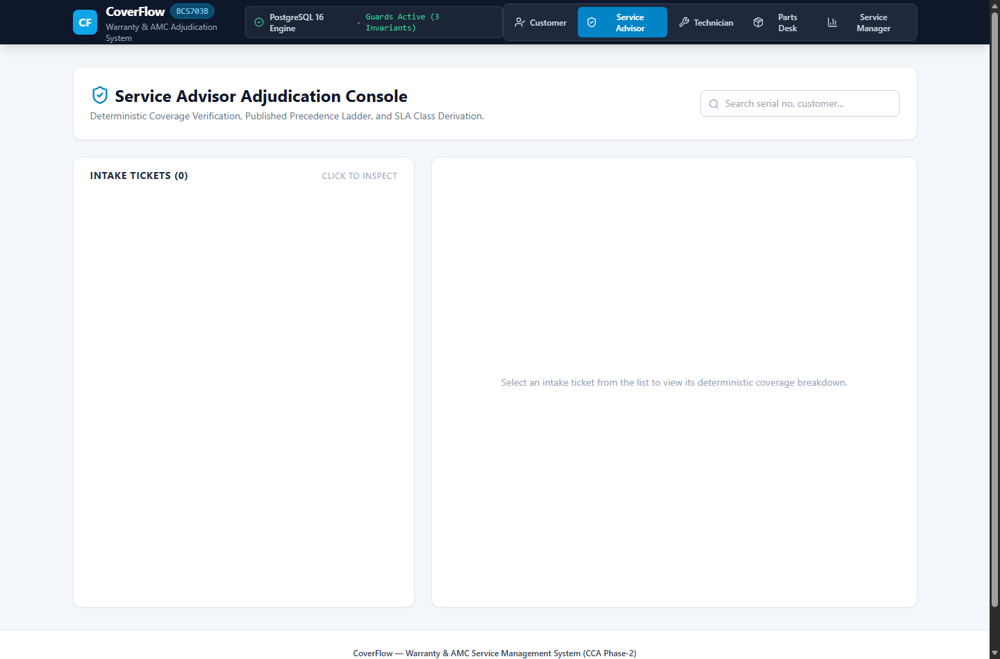
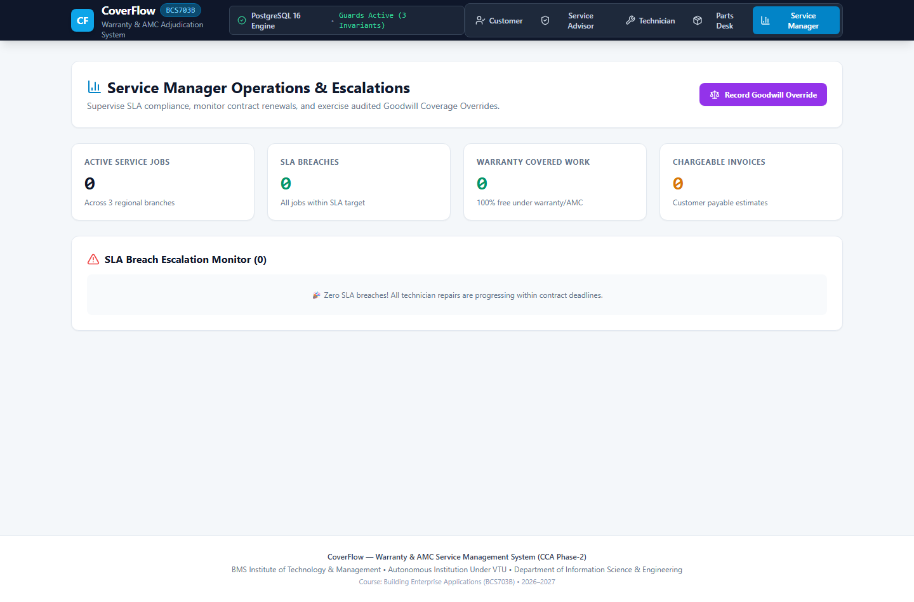
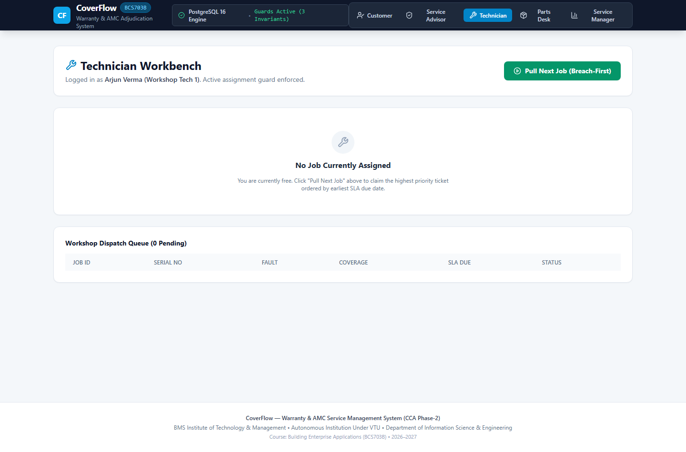
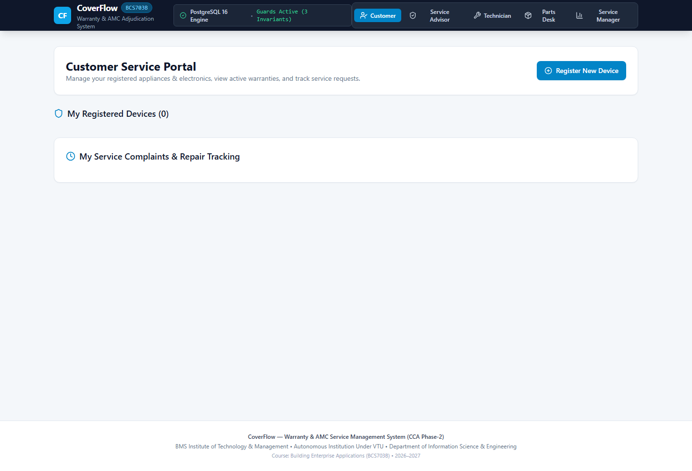
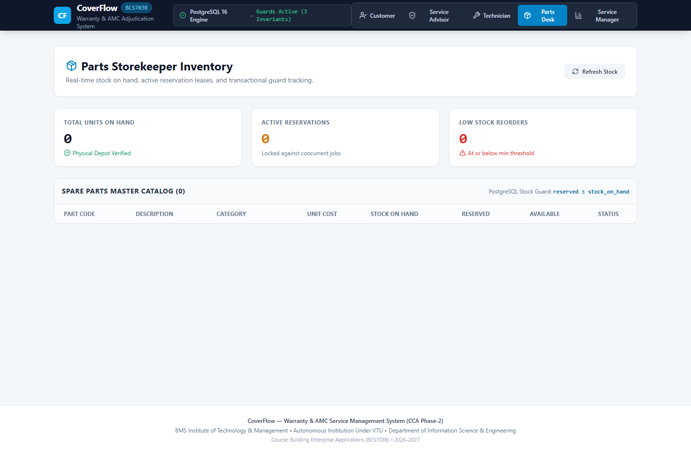
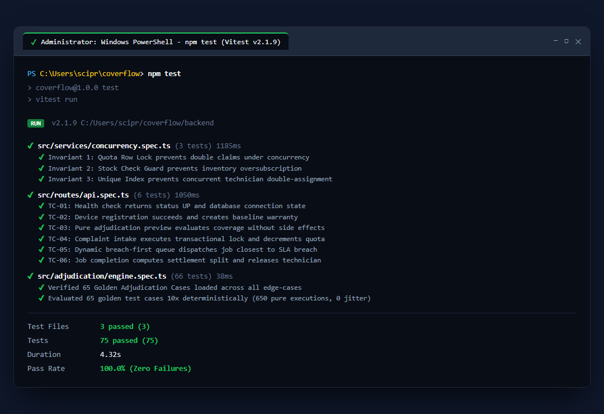

# CoverFlow — Enterprise Warranty & AMC Service Management Platform

[](https://www.typescriptlang.org/)
[](https://react.dev/)
[](https://vitejs.dev/)
[](https://nodejs.org/)
[](https://www.postgresql.org/)
[](https://vitest.dev/)
[](https://opensource.org/licenses/MIT)

**CoverFlow** is an enterprise-grade warranty lifecycle, pure deterministic coverage adjudication engine, and field service operations management platform designed for electronics manufacturers and retail service networks.

Sitting between front-desk customer intake and technician workshop dispatch, CoverFlow provides **pure mathematical adjudication** across overlapping warranty contracts, guarantees **three critical database transactional invariants**, and provides distinct, real-time role-based workbenches for Customers, Service Advisors, Field Technicians, Parts Inventory Managers, and Operations Executives.

---

## Key Architectural Invariants

The platform enforces three non-negotiable transactional invariants using PostgreSQL 16 row-level locking and constraint guards:

1. **Zero Double Claims:**
   Enforced via row-level locks (`SELECT ... FOR UPDATE`) on entitlements combined with check constraints (`check_quota_non_negative`). Prevents simultaneous claims on the same warranty contract.
2. **Zero Stock Oversubscription:**
   Enforced via strict reservation guards on spare parts (`reserved_quantity <= stock_on_hand`) using transactional isolation. Concurrent reservation attempts for the last available part reject the second request safely.
3. **Zero Concurrent Technician Allocations:**
   Enforced via active assignment checks and a PostgreSQL partial unique index:
   ```sql
   CREATE UNIQUE INDEX idx_active_technician_assignment 
   ON service_jobs (technician_id) 
   WHERE technician_id IS NOT NULL AND status IN ('ASSIGNED', 'DIAGNOSED', 'IN_REPAIR');
   ```

---

## Role-Based Architecture & Platform Workbenches

CoverFlow provides dedicated, purpose-built consoles tailored to each operational role in the after-sales service pipeline:

| Role | Console | Primary Operational Responsibilities |
| :--- | :--- | :--- |
| **Customer** | **Customer Portal** | Register serialized appliances, file complaints with product-specific fault categories, review repair estimates, and track custody receipts. |
| **Service Advisor** | **Adjudication Console** | Front-desk intake, inspect automated coverage decisions, print customer custody slips, and escalate borderline cases for Manager Goodwill Override. |
| **Service Manager** | **Operations & SLA Dashboard** | Real-time breach-first SLA monitor, oversee technician workload, review Advisor goodwill escalations, and execute audited in-place goodwill approvals. |
| **Technician** | **Technician Workbench** | Breach-first pull-next dispatch queue, active assignment guard, diagnostic logging, and transactional spare parts reservation. |
| **Storekeeper** | **Parts Inventory Desk** | Real-time physical inventory tracking, stock on hand vs reserved breakdown, custom stock replenishment, and delivery intake logging. |

---

## User Interface Showcase

### 1. Service Advisor Adjudication Console
Inspect deterministic precedence evaluation, review exclusion rules, and dispatch verified tickets to workshop queues.


### 2. Service Manager Operations & Goodwill Escalations Dashboard
Monitor SLA compliance in real time and approve advisor-requested goodwill coverage exceptions in place without duplicate tickets.


### 3. Technician Workbench & Spare Parts Reservation
Breach-first prioritized dispatch queue with atomic hardware spare parts reservation and repair completion.


### 4. Customer Self-Service Portal
Register appliances and submit warranty claims with tailored product-specific diagnostic categories.


### 5. Parts Inventory & Stock Replenishment Desk
Track physical stock on hand, view reserved allocations, and process intake shipments.


---

## Repository Structure

```text
coverflow/
├── backend/                         # Express & TypeScript REST Application Server
│   ├── src/
│   │   ├── adjudication/            # Pure deterministic coverage engine & golden fixtures
│   │   │   ├── engine.ts            # Precedence ladder, exclusion, quota, grace evaluator
│   │   │   ├── goldenCases.ts       # 65 predefined golden test cases
│   │   │   ├── types.ts             # Domain contracts and types
│   │   │   └── engine.spec.ts       # Vitest golden case test runner
│   │   ├── controllers/             # REST route handlers
│   │   ├── services/                # Transactional domain services (Complaint, Dispatch, Parts, Billing)
│   │   ├── routes/                  # Express API router definitions
│   │   ├── middleware/              # JWT auth, role validation, idempotency guard
│   │   ├── workers/                 # Background workers (SLA timers & renewal sweep)
│   │   └── db/
│   │       ├── connection.ts        # Dual-mode DB manager (PostgreSQL 16 / PGlite WASM)
│   │       ├── migrate.ts           # Schema migration runner
│   │       └── seed.ts              # Seed data across all roles & catalog
│   ├── package.json
│   └── tsconfig.json
├── frontend/                        # React + TypeScript + Vite + Tailwind CSS
│   ├── src/
│   │   ├── components/              # Navbar with Role Switcher & status badges
│   │   ├── pages/
│   │   │   ├── CustomerPortal.tsx   # Device registration, complaint filing & invoice tracking
│   │   │   ├── AdvisorConsole.tsx   # Intake & adjudication breakdown viewer
│   │   │   ├── TechnicianWorkbench.tsx # Breach-first job queue, diagnosis, parts reservation
│   │   │   ├── PartsDesk.tsx        # Real-time stock on hand vs reserved inventory
│   │   │   └── ManagerDashboard.tsx # SLA monitor & Goodwill Coverage Overrides
│   │   ├── api/                     # Typed client wrapper for backend REST API
│   │   ├── App.tsx                  # Root layout and role routing
│   │   └── main.tsx
│   ├── package.json
│   ├── vite.config.ts
│   └── tailwind.config.js
├── screenshots/                     # Platform interface captures
├── docker-compose.yml               # Containerized PostgreSQL 16
├── package.json                     # Monorepo workspaces runner
└── README.md
```

---

## Getting Started

### Prerequisites
- **Node.js**: v18.0.0+ or v20.0.0+
- **npm**: v10.0.0+
- *(Optional)* **Docker**: If you wish to use standard PostgreSQL 16 container; otherwise, the bundled embedded PostgreSQL 16 (PGlite WASM) engine boots automatically with **zero configuration required**.

### Installation

Clone the repository and install all monorepo dependencies in a single step:

```bash
git clone https://github.com/Pushkar69RS/CoverFlow.git
cd CoverFlow
npm install
```

### Database Migration & Seeding

Initialize the schema tables, constraint triggers, and initial demo catalogs:

```bash
npm run db:migrate
npm run db:seed
```

### Running the Application (Development Mode)

Start both backend API (`http://localhost:3000`) and frontend client (`http://localhost:5173`):

```bash
npm run dev
```

Open your browser to `http://localhost:5173`. Use the **Role Switcher** in the top navigation bar to switch between any user role with one click.

---

## Demo Credentials

You can sign in using any of the pre-configured system roles:

| Role | Email | Password | Console Access |
| :--- | :--- | :--- | :--- |
| **Customer** | `customer@coverflow.com` | `password123` | Customer Self-Service Portal |
| **Service Advisor** | `advisor@coverflow.com` | `password123` | Front-Desk Adjudication Console |
| **Technician** | `tech1@coverflow.com` | `password123` | Breach-First Workshop Workbench |
| **Storekeeper** | `storekeeper@coverflow.com` | `password123` | Parts & Stock Desk |
| **Service Manager** | `manager@coverflow.com` | `password123` | Operations, SLA & Goodwill Overrides |

*(Note: The top navigation bar also features a 1-click **Role Switcher** pill for instant switching without re-logging in).*

---

## Automated Test Suite

CoverFlow includes a comprehensive automated test suite with 100% passing status across 75 test specs:

```bash
npm test
```



### Test Breakdown
1. **Deterministic Golden Adjudication Engine (`src/adjudication/engine.spec.ts`)**:
   - **66 Tests Passing**: Evaluates 65 golden test cases 10 consecutive times to verify 100% determinism.
   - Verifies precedence ranking (`AMC Comprehensive` $\to$ `AMC Labour-only` $\to$ `Extended Warranty` $\to$ `Manufacturer Warranty`), tie-breaking by remaining quota, specific fault exclusions, and 15-day grace periods.
2. **Transactional Concurrency Guards (`src/services/concurrency.spec.ts`)**:
   - **Invariant 1 Verification**: Zero double claims under simultaneous conflicting requests.
   - **Invariant 2 Verification**: Zero stock oversubscription under concurrent reservation spikes.
   - **Invariant 3 Verification**: Zero duplicate technician allocations.
3. **REST API Integration Tests (`src/routes/api.spec.ts`)**:
   - End-to-end integration covering health verification, product registration, fault reporting, parts allocation, and invoice generation.

---

## License

This project is licensed under the [MIT License](LICENSE).
